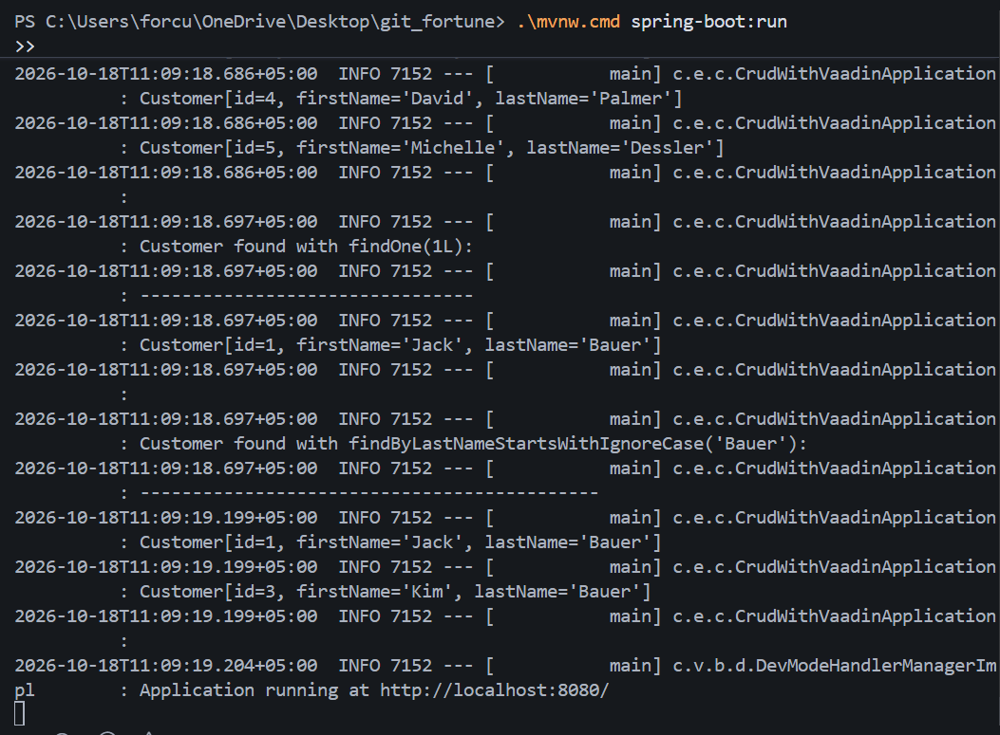
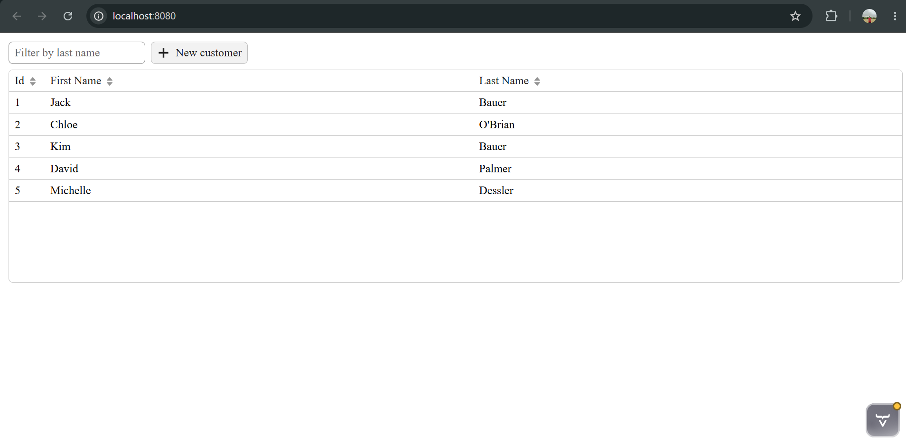
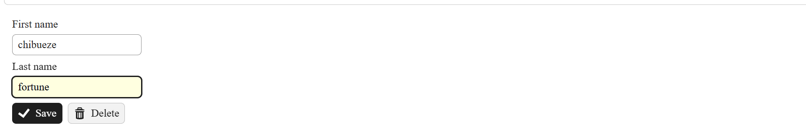

# Project Documentation & Screenshots

Screenshots demonstrating the local execution and functionality of the application:

### 1. Application Startup Logs
Shows that the Spring Boot application started successfully and is running at `http://localhost:8080/`.

---

### 2. Running Application
Shows the web UI loaded in the browser with the customer grid and search filter.

---

### 3. CRUD Functionality
Shows adding and editing customer details (creating customer `chibueze fortune`).

